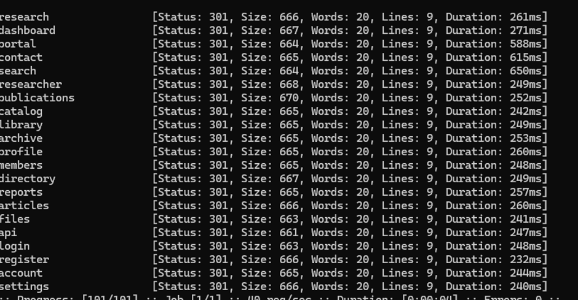

# Title

404 Response-Based Content Discovery Identified Potential Routes and Redirect Behavior

## Affected URL

https://research.pwnedbox.site/

## Description

A web content discovery assessment was conducted against the target domain to identify potentially valid routes, files, and directories by analyzing HTTP responses to candidate paths.

The assessment began by submitting a nonexistent path to establish the baseline error response. Content discovery and enumeration techniques were subsequently used to identify potentially valid application routes, including `/publications.php` and `/researchers.php`.

Further enumeration was performed against the `/subdomains/` path, which returned numerous candidate paths and redirects. The identified routes were found to redirect to other pages during subsequent testing.

The assessment successfully identified potential application routes and redirect behavior. However, the results did not establish unauthorized access, sensitive information disclosure, or another confirmed security vulnerability.

## Steps to Reproduce

1. Navigate to the target domain: https://research.pwnedbox.site/

2. Submit a nonexistent path to observe the server's baseline error response.
3. Perform web content discovery to identify potentially valid files, directories, and application routes.
4. Observe the following routes identified during enumeration:
   - https://research.pwnedbox.site/publications.php
   - https://research.pwnedbox.site/researchers.php
5. Enumerate the `/subdomains/` path: https://research.pwnedbox.site/subdomains/
 
6. Observe that the enumeration produces numerous candidate paths and redirects.
7. Access the identified routes individually and verify their HTTP response and redirect behavior.

## POC

The following routes were identified during content discovery:

**Route 1: Publications**

https://research.pwnedbox.site/publications.php

**Route 2: Researchers**

https://research.pwnedbox.site/researchers.php

**Route 3: Subdomains directory**

https://research.pwnedbox.site/subdomains/

During enumeration, the identified routes exhibited redirect behavior. The screenshots captured during testing provide supporting evidence of the discovered routes and observed responses.

*Note: The available results establish route discovery and redirects only. The final redirect destinations, HTTP status codes, and any security-relevant behavior should be documented separately if confirmed during testing.*

## Impact

No direct security impact was confirmed during this assessment.

Potential implications, depending on further validation, include:

1. Discovery of application endpoints that may warrant additional security testing.
2. Identification of routes that could expose functionality or information if access controls are improperly implemented.
3. Discovery of redirect behavior that may warrant further investigation if it leads to unexpected destinations or reveals sensitive information.
4. Improved understanding of the application's externally accessible content and routing structure.

These are potential areas for further investigation, not confirmed vulnerabilities.

## Remediation

1. Review externally accessible routes and ensure that each endpoint exposes only intended functionality.
2. Enforce appropriate authentication and authorization controls on restricted resources.
3. Verify that redirects use expected destinations and do not introduce open redirect vulnerabilities.
4. Configure consistent HTTP responses for nonexistent resources where appropriate, without relying on response codes alone as a security control.
5. Review the `/subdomains/` path to determine whether its contents and redirect behavior are intentional.
6. Continue testing any discovered endpoints for access-control weaknesses, information disclosure, and other security issues before assigning a vulnerability classification.

## Conclusion

The assessment identified `/publications.php` and `/researchers.php` and observed multiple candidate paths and redirects during enumeration of `/subdomains/`. The discovered routes did not establish a confirmed vulnerability. Additional testing would be required to determine whether the observed behavior presents a security risk.

