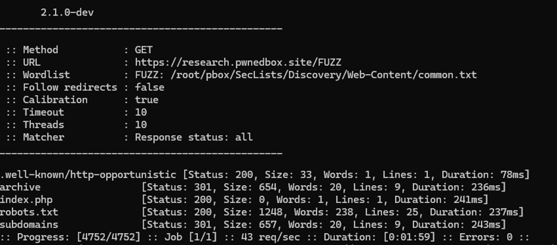
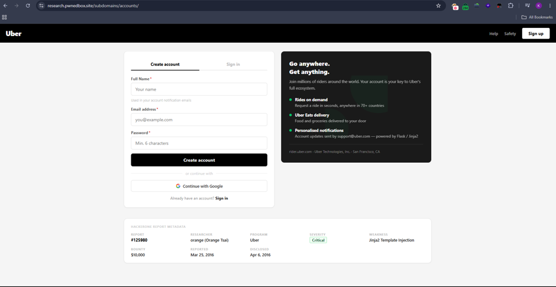

LAB 2:
404 Response Based content discovery.

Lab: 404 Response-Based Content Discovery
- Target: https://research.pwnedbox.site/
- Assessment type: Web content discovery / directory and file
  enumeration
- Status: Partial --- routes were identified, but do not
  establish a confirmed vulnerability.
Objective
Investigate how the target responds to invalid requests and use content
discovery techniques to identify potentially valid routes, files, and
directories.

404 response-based content discovery (also called predictable resource
location or fuzzing) involves testing candidate paths and interpreting
server responses to distinguish potentially valid resources from invalid
ones.
Methodology:
 1.Submitted a false or nonexistent path to observe the site's baseline
   error response.
   
 
Identifies the main routes:
https://research.pwnedbox.site/publications.php
https://research.pwnedbox.site/researchers.php

2. Enumerated the domain:

 
3. Further enumerated the /subdomains: https://research.pwnedbox.site/subdomains/ FUZZ
 
found too many paths and redirects on this .
  

Conclusion:
Identified routes
The following routes were identified during discovery:
- /publications.php
- /researchers.php
After enumeration the routes were found but they redirected to other pages.
