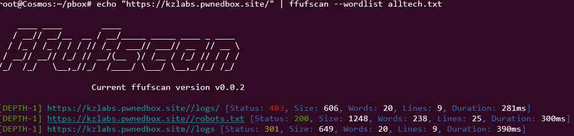
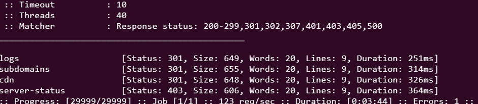
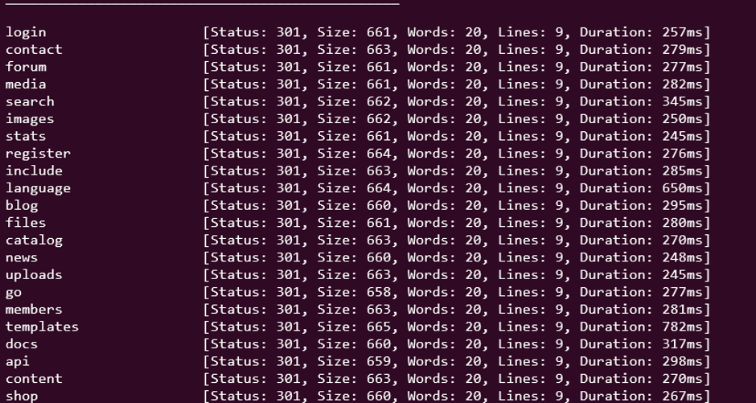
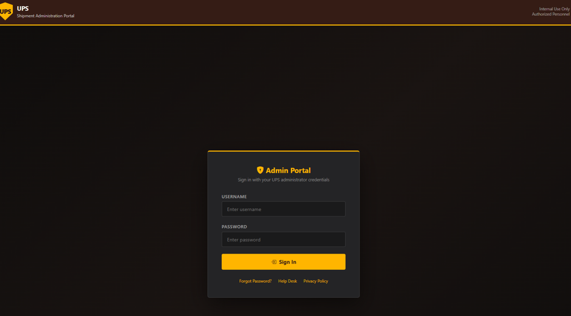
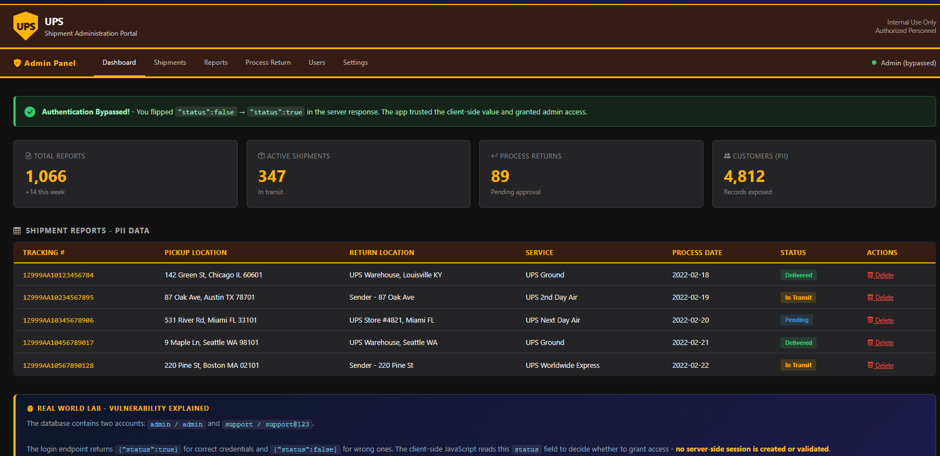
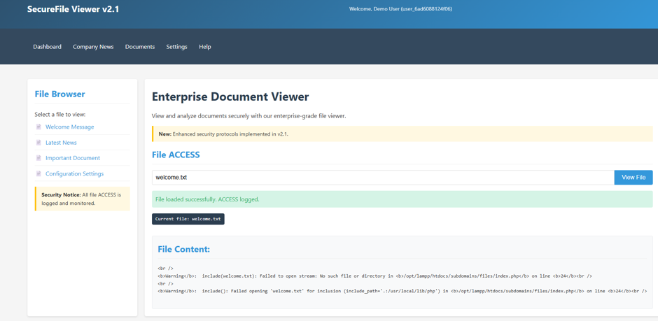

Lab 3:
CloudSync: Sensitive Data Exposure and Credential Leakage
Overview
•	Lab: CloudSync: Sensitive Data Exposure and Credential Leakage
•	Target: https://kzlabs.pwnedbox.site/
•	Assessment type: Web directory discovery and review of
potentially sensitive routes
•	Status: Preliminary --- candidate routes and a possible path
traversal issue are noted, but the available evidence does not fully
validate exploitability or impact.
Directory Fuzzing:
Directory discovery was performed with ffufscan and ffuf, using the
alltech.txt and SecLists raft-medium-directories.txt wordlists.
echo "https://kzlabs.pwnedbox.site/" | ffufscan --wordlist alltech.txt

ffuf -u https://kzlabs.pwnedbox.site/FUZZ -w SecLists/Discovery/Web-Content/raft-medium-directories.txt

ffuf -u https://kzlabs.pwnedbox.site/subdomains/FUZZ -w SecLists/Discovery/Web-Content/raft-medium-directories.txt

Findings
1. Admin panel route
https://kzlabs.pwnedbox.site/subdomains/adminpanel/
The lab notes list admin-admin as a default credential. The supplied
notes do not include the authentication request, a successful login
transcript, or evidence confirming whether these credentials work

Users data could be fetched if available.
2. Files route
https://kzlabs.pwnedbox.site/subdomains/files/

Displays the error that can lead to path traversal vulnerability

Conclusion
Directory fuzzing identified an admin panel candidate and a files route.
The notes also mention a possible path traversal indicator. However, the
available evidence does not establish that the default credentials are
valid, that user data was successfully accessed, or that path traversal
was exploitable.

